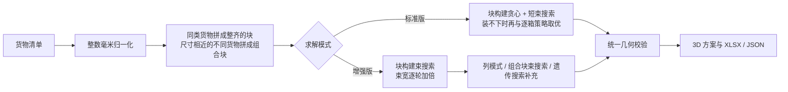

<p align="center">
  
</p>

<p align="center">
  面向真实装柜约束的三维装箱系统。把货物清单转化为可执行、可复核、可导出的装载方案。
</p>

<p align="center">
  <a href="https://loader-hyt.streamlit.app/"><strong>打开在线工作台 →</strong></a>
  &nbsp;&nbsp;·&nbsp;&nbsp;
  <a href="#本地运行">本地运行</a>
  &nbsp;&nbsp;·&nbsp;&nbsp;
  <a href="#算法与约束">算法说明</a>
</p>

---

## 产品概览

HYT Container Load Planner 接收集装箱尺寸与货物清单，计算每件货物的摆放位置和朝向，并在同一工作台内完成数据录入、实时预估、三维复核与方案交付。

<p align="center">
  
</p>

| 计算 | 复核 | 交付 |
| :--- | :--- | :--- |
| 标准版用块构建贪心快速出方案；增强版以块构建束搜索为主，在时限内持续改进 | 整数毫米几何内核逐件校验边界、碰撞、朝向与支撑 | Excel / JSON 双格式导出；保存的方案可重新导入网站查看 |

## 为什么是它

- **以空间利用率为第一目标**：先最大化已装货物体积，同体积下再比较件数与底层偏好。
- **业内主流算法**：采用单箱装载问题中成绩最好的「块构建 + 极大空闲空间 + 束搜索」思路，在国际通用测试集上达到 92%–95% 的空间利用率。
- **结果只会更好**：新算法与原有逐箱、列模式等策略同时参与比较，只采用最优方案；增强版不劣于标准版。
- **为真实操作设计**：支持六向旋转、禁止倒放、重货/密度底层优先（可严格执行）、不可压货物，并保证每件货物重心有支撑、不会悬空。
- **计算结果可解释**：三维视图支持类别高亮、透明模式和长/宽/高分段查看。
- **输入输出闭环**：网页表格、TXT、XLSX 均可作为清单入口；方案可导出为 XLSX 或 JSON 后再次载入。

## 算法与约束



块构建束搜索（`block_engine.py`）参考 Fanslau & Bortfeldt（2010）、Zhu & Lim（2012）、Araya & Riff（2014）等方法：
同种、同朝向的货物先拼成 nx×ny×nz 的整齐块；尺寸相近的不同货物再两两拼成组合块（外包长方体至少 99.5% 被填满）；
柜内剩余空间用相互重叠的「极大空闲空间」记录，不漏可放位置；每步在离柜角最近的空间放「体积大、留下无用缝隙少」的块；
束搜索同时保留多个部分方案，以贪心补全后的装载体积排序，束宽逐轮加倍，时间越长结果越好。

- **标准版**：依次尝试块构建贪心、按次数封顶的短束搜索和组合块贪心，任何一步已全部装入就立即返回；
  都装不下时再与原有逐箱策略比较取优。不按时间截断，同样的输入结果完全一致。
- **增强版**：简单块束搜索占预算前 55%；随后是列模式、逐箱策略等原有策略；组合块束搜索使用剩余时间。
  所有候选统一比较，只采用最优方案，因此不劣于标准版。

所有候选最终都经过同一套硬约束内核：

1. **边界**：货物六个面均不得超出集装箱内尺寸。
2. **碰撞**：任意两件货物的三维实体不得相交。
3. **支撑**：非落地货物的底面中心必须落在下方接触面范围之内（重心有支撑），不会悬空或倾倒。
4. **朝向**：普通货物可尝试六种正交旋转；禁止倒放货物只允许绕竖直轴旋转。
5. **叠放（可选）**：勾选「不可压」的货物顶上不放任何货物；打开「严格执行」后，上层货物的重量或密度
   （随所选底层优先指标）不得大于它直接压着的任何一件货物，数值相同可以叠放，未填重量的货物不参与比较。
   已有货物悬挑部分的底面恰好落在新货物顶面上时，同样按「压在上面」判断。

重量与密度默认属于底层摆放的软偏好，不会作为硬约束牺牲已装体积；只有打开「严格执行」或勾选「不可压」后
才成为硬约束。此时标准版与增强版还会额外尝试「重 / 密度大的块先占底层」的块排序，与默认排序比较取优。
规则会减少可行摆法，装不下时结果会提示取消限制后至少可装多少件。

### 国际测试集（Bischoff & Ratcliff）

每组取前 10 题，严格遵守题目规定的可竖放方向，货物总体积约为柜容积的 99.5%。BR8、BR10 来自 OR-Library
的扩展测试集（br.zip）。「当前」两列要求每件货物重心有支撑；「初版」两列在当时的 60% 底面支撑规则下测得。

| 测试组 | 货物种类 | 初版标准版 | 初版增强版 | 当前标准版 | 当前增强版（30 秒） |
| :--- | ---: | ---: | ---: | ---: | ---: |
| BR1 | 3 | 87.0% | 88.5% | 92.1% | **93.4%** |
| BR4 | 10 | 83.5% | 83.5% | 91.8% | **94.5%** |
| BR7 | 20 | 81.8% | 81.8% | 90.9% | **94.1%** |
| BR8 | 30 | — | — | 90.5% | **93.3%** |
| BR10 | 50 | — | — | 89.9% | **92.3%** |

### 客户清单回归

| 数据规模 | 初版增强算法 | 上一版 | 当前增强算法 | 体积利用率 | 求解时间* |
| :--- | ---: | ---: | ---: | ---: | ---: |
| 435 件 / 5 类 | 424 / 435 | 435 / 435 | **435 / 435** | 90.35% | **不到 0.1 秒** |
| 435 件 / 5 类（全部禁止倒放） | — | 422 / 435 | **427 / 435** | **88.77%** | 用满时限 |
| 613 件 / 9 类 | 601 / 613 | 613 / 613 | **613 / 613** | 84.83% | **约 0.1 秒** |

<sub>* 开发机回归结果。实际时间受硬件、清单结构和搜索上限影响；找到全装方案后会立即停止。</sub>

## 本地运行

要求 Python 3.12 或更高版本。

```bash
git clone https://github.com/hyt0019/loader.git
cd loader
pip install -r requirements-server.txt
python -m uvicorn server.main:app --port 8000
```

浏览器打开 `http://localhost:8000`。网页是纯静态文件，无需前端构建；三维查看、高亮、分段等交互都在浏览器中完成，
服务器只负责计算与文件导入导出。货物清单和最近一次结果会自动保存在浏览器中，刷新页面不会丢失。

旧版 Streamlit 工作台仍然保留：`pip install -r requirements_web.txt && streamlit run app.py`（或运行 `run_web_app.bat` / `run_web_app.command`）。

## 使用流程


### 清单格式

TXT 文件使用以下结构，尺寸单位为米：

```text
5.8 2.35 2.35
2
0.49 0.40 0.09 44 18 1
1.20 1.00 1.35 7 1472 0
```

第一行为集装箱长、宽、高；第二行为货物种类数；后续每行依次为长、宽、高、数量、重量、类型。类型 `0 / 1 / 2` 分别表示木箱、纸箱和托盘。网页也支持直接编辑表格或导入网站导出的 XLSX；禁止倒放、优先级和不可压只保存在 XLSX 清单中。

## 系统结构

```text
server/                   网站后端（FastAPI）：计算任务调度（独立子进程、排队、取消）与文件接口
web/                      网站前端：静态页面 + Three.js 三维查看器（web/vendor 为按需打包的 three.js）
planner_core.py           清单解析、方案导入导出、实时预估等通用逻辑（网站与 Streamlit 版共用）
packer_pro.py             整数几何内核、标准与增强求解器（也可作为桌面命令行运行）
block_engine.py           块构建 + 极大空闲空间 + 束搜索，以及重心支撑判断
app.py                    旧版 Streamlit 工作台
tests/                    算法、方案导入与网站接口回归测试
deploy/                   Caddy 配置与服务器部署说明
Dockerfile                网站镜像；docker-compose.yml 同时启动网站与 Caddy（自动 HTTPS）
sample_data.txt           可直接导入的示例清单
```

网站、Streamlit 版与桌面命令行调用的是 `packer_pro.py` 中同一套求解与校验逻辑。

## 部署

**自有服务器（Docker，推荐）**：仓库自带 `Dockerfile` 与 `docker-compose.yml`，由 Caddy 自动签发 HTTPS 证书。

```bash
cp .env.example .env        # 填写 DOMAIN=你的子域名
docker compose up -d --build
```

域名解析、防火墙、国内镜像源、已有 nginx 等完整步骤见 [deploy/README.md](deploy/README.md)。

**Streamlit Community Cloud（旧版）**：选择本仓库和目标分支，入口文件填写 `app.py`。

## License

基于 [MIT License](LICENSE) 发布。

<p align="center">
  <sub>Designed &amp; engineered by HYT · Container Load Planner</sub>
</p>
